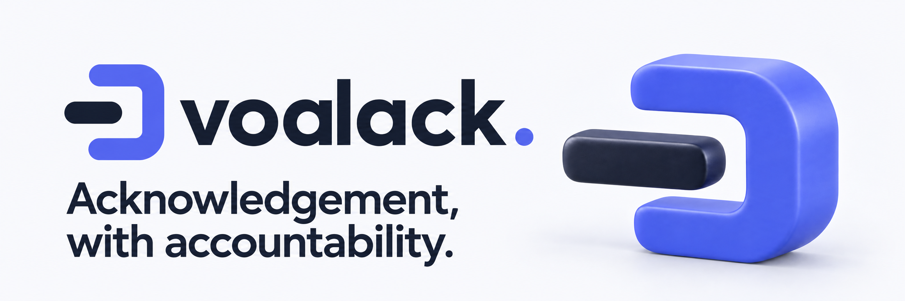
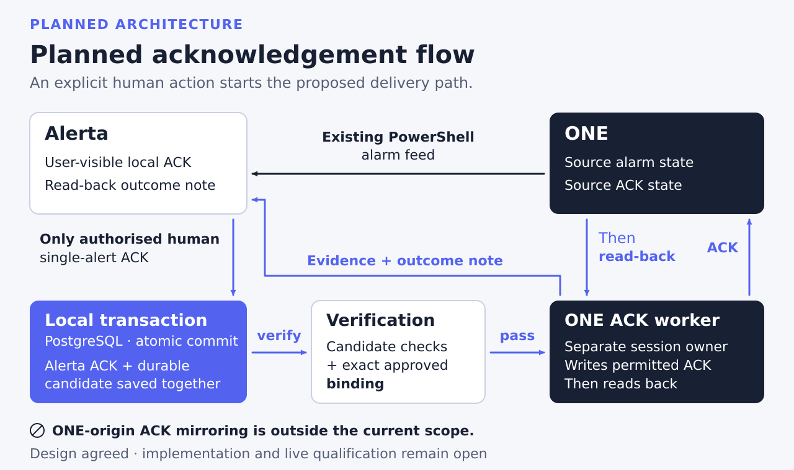
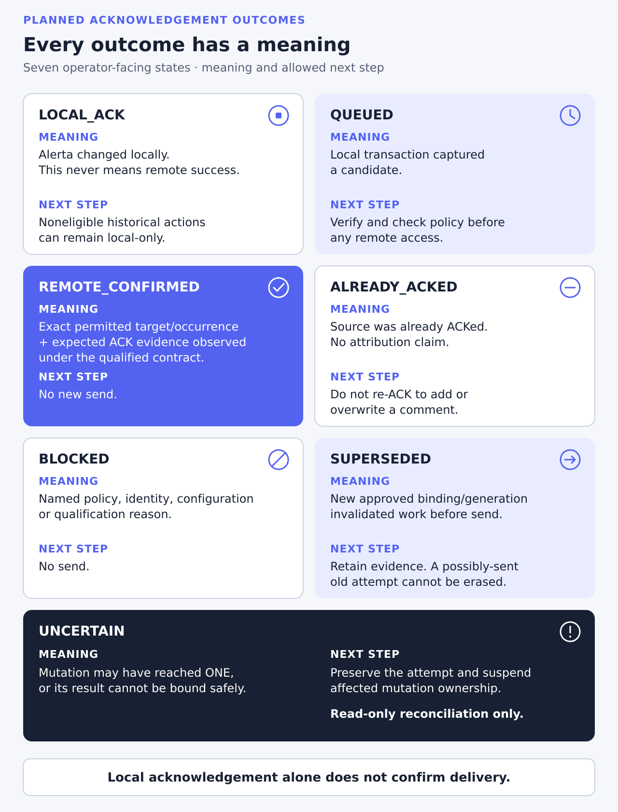

<div align="center">
  <picture>
    <source media="(prefers-color-scheme: dark)" srcset="docs/assets/readme-hero-dark.png">
    
  </picture>
  <h1>Voalack</h1>
  <p><strong>Acknowledgement, with accountability.</strong></p>
  <p>An Alerta integration in development for durable, attributable acknowledgement delivery to Veeam ONE,<br>alongside the existing ONE alarm feed.</p>
  <p>
    
    
    
  </p>
  <p><a href="https://voalack.stel.chatgpt.site/">Website</a> · <a href="#what-it-does">What it does</a> · <a href="#status">Status</a> · <a href="#architecture">Architecture</a> · <a href="#getting-started">Getting started</a> · <a href="#documentation">Documentation</a> · <a href="#roadmap">Roadmap</a></p>
</div>

> [!IMPORTANT]
> **Development, not qualified for use.** The capture boundary and the durable delivery ledger are implemented and tested against a **loopback fake Veeam ONE provider** only. No real Veeam ONE has been contacted, live writes stay disabled, and no installable release exists. The recorded 32-test result covers only the **original synchronous ACK MVP**.

## What it does

Voalack is being developed for Service Desk, engineering and NOC teams that use Alerta as their shared alert console. The existing PowerShell feed brings Veeam ONE alarms into Alerta. The new integration is intended to carry an **authorised human single-alert acknowledgement** back to the exact approved ONE alarm, retaining the operator's context and a clear delivery outcome.

| Direction | Scope |
| --- | --- |
| ONE → Alerta | Preserve the existing alarm feed. |
| Alerta → ONE | Deliver an eligible human acknowledgement with integration identity, verified operator attribution, request time and note. |
| ONE-origin acknowledgements → Alerta | Not mirrored. An implemented, off-by-default observer records typed state only in Voalack's ledger. |
| Other mutations | Unacknowledgement, resolve/delete, bulk/grouped targets and arbitrary comment synchronisation are outside the current write-back scope. |

The integration service account performs the ONE API action; the comment identifies the requesting Alerta user. A local ACK alone never establishes remote success. [Scope and delivery contract](design/DESIGN.md) · [Agreed amendments](design/DESIGN_AMENDMENTS.md)

## Status

Commit identifiers in this README refer to the private development history; this public repository starts from a single snapshot of the reviewed tree. Evidence checked **8 October 2026** at the reviewed S4 commit `759e59c` (earlier stages at `32e72d7`). Each stage below was merged only after independent review of its exact commit. Its PostgreSQL and Alerta tests run in disposable microVMs; that evidence is recorded with each review, outside this repository. The repository's GitHub CI jobs are narrower: they run the ACK-core, envelope and launcher tests only, not the PostgreSQL capture, delivery or recovery suites.

| Area | State | Evidence and limits |
| --- | --- | --- |
| Original feed and ACK MVP | Preserved inputs | Earlier prototypes are retained in [`inputs/original/`](inputs/original); [`inputs/INPUTS.md`](inputs/INPUTS.md) records provenance and redactions. |
| T01 design | Accepted with amendments | [Design](design/DESIGN.md), [implementability review](design/DESIGN_REVIEW.md) and [A1–A5 concurrence](design/DESIGN_AMENDMENTS.md). |
| Original ACK MVP reproduction | 32 tests passed | [Report](baseline/BASELINE_REPORT.md). Rebuilt, installed wheel in isolated Linux with a mocked database boundary; not evidence for the new architecture. |
| Shared ACK core | Implemented; used by Voalack's signed intents | [Core package](packages/ack-core): canonical encoding, signing profiles, validation and typed outcomes; installed-wheel tests in CI. |
| Zabalack compatibility experiment | Scoped local evidence | [T02 report](compat/t02/README.md); not merged into Zabalack. |
| Continuous integration | Implemented; scoped checks | GitHub-hosted runners for package and mocked-launcher tests, with a read-only token and no repository secrets. Outside-contributor approval is a separate repository setting; full capture qualification runs in disposable microVMs ([CI design](docs/CI.md)). |
| Capture boundary and signed intents (T03b) | Implemented and tested | Real Alerta 9.1.0 and PostgreSQL in the test guest: transaction boundary, authorisation gate, signed intents under a restricted role. [Package notes](packages/voalack/README.md). |
| Verifier, effect ledger and send path (T04 S1–S3a) | Implemented; fake provider only | One active, lease-fenced verifier claim per capture at a time and at most one promoted effect, one session owner per ONE instance, a one-time dispatch permit, physical-target guards, and retries only after a proven not-sent. Anything possibly sent is held `UNCERTAIN` and never resent. |
| Reconciliation and settlement (T04 S3b) | Implemented; fake provider only | Read-only reconciliation; automatic settlement only for an attributed read; operator settlement only after containment and quiescence. Nothing returns to `QUEUED`. |
| Supervised database recovery (T04 S3c) | Implemented; fake provider only | An external recovery record gates provider use. A restored database is adopted with held work, and nothing that may have been sent is sent again. At `32e72d7`: 635 tests passed in a disposable microVM (PostgreSQL 18.6, Alerta 9.1.0), 15 deliberate code mutations each failed their tests, and an independent reviewer re-ran the suite. Limited to an announced, supervised, database-only restore. In a database shared with Alerta, the bare restore command fails; S4 added a shared-database procedure for that earlier layout. With coexistence 3a installed (this release) this recovery refuses: there is no supported restore. |
| Operator projection (T04 S4) | Implemented; fake provider only | One Alerta note per delivery, settlement and recovery outcome, published in order from a protected record that a restore does not roll back. Display only: no send, settlement, hold release or new intent. At `759e59c`: 718 tests passed in a disposable microVM (PostgreSQL 18.6, Alerta 9.1.0), 41 of 42 deliberate code mutations failed their tests (the remaining one is caught by a separate direct entry-point test), and an independent reviewer re-ran the suite. Also added a supervised restore procedure for the shared layout of that time (before coexistence 3a); with coexistence 3a installed it refuses (see the recovery row above). |
| Reverse Veeam ONE state (T05a) | Assessed; not mirrored | Acknowledgements made directly in Veeam ONE are not mirrored into Alerta, and neither are unacknowledgements or comments. The [assessment](design/T05_REVERSE_STATE.md) gives the reasons (ordering, occurrence identity, human identity, precedence, loop suppression, scope) and what read-only reconciliation does instead. At `6248653`, which contains the assessment and its tests: 735 tests passed in a disposable microVM (PostgreSQL 18.6, Alerta 9.1.0), 8 deliberate code mutations each failed their tests, and an independent reviewer reviewed the exact commit. The tests show that reading back Voalack's own ACK creates no new action, intent or ACK. Since then, an optional evidence-only observer (T05b) records ONE's state in Voalack's own ledger and never projects it into Alerta (see the [package README](packages/voalack/README.md)). |
| Ledger-only source observer (T05b) | Implemented; off by default; fake provider only | Records a typed, minimized ONE-state summary in Voalack's own ledger. It cannot ACK, write Alerta notes, settle, release holds or create intent. See [package notes](packages/voalack/README.md#ledger-only-source-observer-t05b-fake-one-provider-only). |
| Coexistence in one Alerta database (3a S1–S3b) | Implemented; fake provider only | Public-table ownership classes with foreign pass-through, alert lifetimes and ownership protections with their migration, a DDL guard over the protected objects, and supervised containment windows with a journal. A restore of a database that Voalack shares with another product is not supported in this release, and the planned coexistence restore (3a S3c) is not part of it; the T04 S3c recovery above describes Voalack-only and pre-3a layouts at their historical commits, and with coexistence 3a installed it refuses. |
| Live operation | Not qualified | No real Veeam ONE, deployed Duo/OIDC, Windows feed or target-site installed deployment has been exercised (the lab tests use installed wheels in a disposable guest). Automatic live writes remain disabled while the enablement holds are unresolved. |

### Public repository checkpoint — 2 November 2026

This public repository begins at
[`592ce769`](https://github.com/steliosx/voalack/tree/592ce769ce1c309d93e1ed34e3872c24ea8ebe5e).
Current main and `vo/integration` match
[`3ca8bb6b`](https://github.com/steliosx/voalack/commit/3ca8bb6bd3cb5e86023d65540b85fee011e6c28d).
Earlier identifiers below refer to private development history, not commits
assumed available in this repository. The snapshot does not establish new
qualification of the inherited product.

Merged [PR #3](https://github.com/steliosx/voalack/pull/3) adds pinned gitleaks
8.24.3 checks over reachable history, current tree and bounded zip/wheel members.
The archive extraction path correction prevents the scanner's default zip-path
allowlist from silently skipping extracted contents. The guard fails when members
exist but the archive scan reports zero bytes. It does not cover archive versions
found only in history, every binary format or secrets absent from the rule set.
See [CI coverage](docs/CI.md).

[Exact-main CI 41501760593](https://github.com/steliosx/voalack/actions/runs/41501760593)
passed **48 installed ACK-core tests, 87 installed envelope tests and 25
mocked-launcher tests** (160 total), plus the separate secrets job. Its extraction
and three scan status codes were zero with no report missing. These are scoped
checks, not a separate whole-repository security review. Original VO-ASTRA
exact-head signed review and independent trial records were not available to this
presentation review; a shared account and green CI do not establish that review.

The source keeps the early alerts-table lock in schema application.
Coexistence 3a S1–S3b is present; with those protections installed the supervised
restore refuses. There is **no supported coexistence-3a restore** and no S3c
acceptance implied by historical recovery results. Hosted CI does not execute the
PostgreSQL capture, coexistence, observer, sender or recovery qualification suites.

Unmerged [PR #1](https://github.com/steliosx/voalack/pull/1), head `8b06cad6`,
removes the dispatch-only Forgehold smoke workflow. Current main still contains
it. The PR must reconcile the newer CI documentation before merge; its stated
outside-contributor approval setting cannot be verified by this connector and
remains separate from designated exact-head review. Forgehold records that the
new public repository is disconnected from its lane.
The [CI documentation](docs/CI.md) describes hosted jobs under the later owner
direction, while the [charter](docs/CHARTER.md) retains the earlier microVM CI
wording; maintainers need to reconcile those records.

No release, live ONE validation, occurrence/conditional-write qualification
or target-site installed acceptance is established by this snapshot or CI.

## Architecture

Implemented against a fake provider; live use is not qualified. The transaction boundary saves an eligible local Alerta ACK and its signed candidate together. A separate verifier checks authority and the exact approved binding before any remote action. One session owner per ONE instance makes a durable attempt before the send, and read-back evidence determines the recorded outcome. An external recovery record keeps a restored database from resending possibly finished work. A separate projector shows each recorded outcome as an Alerta note; it has no delivery capability. An optional, off-by-default observer records typed source-state evidence in its own ledger without creating an ACK, Alerta note, settlement or intent.



The small shared ACK core contains pure encoding, HMAC, validation and outcome primitives; Voalack uses it for its signed intents. Voalack retains its own schema, provider policy, credentials, ONE session owner and delivery behaviour. Zabalack and Voalack must remain independently installable. Compatibility with Alrust requires separate qualification; the current contract targets Alerta 9.1.0.

<details>
<summary><strong>What each delivery outcome means</strong></summary>



| State | Meaning and allowed next step |
| --- | --- |
| `LOCAL_ACK` | The local alert is acknowledged. This does not establish remote success; noneligible historical actions can remain local only. |
| `QUEUED` | The local transaction captured a candidate. Verify authority and policy before any remote access. |
| `REMOTE_CONFIRMED` | The exact permitted target and occurrence have the expected ACK evidence under the qualified contract. Do not send again. |
| `ALREADY_ACKED` | The source was already acknowledged. Do not attribute it to Voalack or send another ACK to add or overwrite the comment. |
| `BLOCKED` | Policy, identity, configuration or qualification prevents the action. Record the reason; do not send. |
| `SUPERSEDED` | A new approved binding or generation invalidated work before send. Retain the evidence; supersession does not erase a possibly sent older attempt. |
| `UNCERTAIN` | A mutation may have reached ONE, or its result cannot be bound safely. Preserve the attempt, suspend affected mutation ownership and reconcile with reads only. |

These are the complete seven operator-facing outcomes in the [design contract](design/DESIGN.md#provider-interface-and-durable-attempts). Internal verification states, pre-send retry delay, expiry and projection-pending are separate. A failed outcome-note projection must not repeat a confirmed remote ACK.

</details>

### Correctness boundaries

- Only a server-authenticated, authorised human single-alert ACK can create executable intent. API keys, ingestion, ordinary notes and mutable attributes cannot manufacture human authority.
- Administrator-owned bindings select the customer, ONE instance and source occurrence. Names, feed combination IDs and capture timestamps are not sufficient target authority.
- The exact actor, target, revisions and final comment are bound to the authenticated intent; provider namespaces and keys remain distinct.
- An ambiguous, possibly sent request must not be blindly repeated. A database lease does not fence remote I/O already in flight.
- ONE occurrence and conditional-write guarantees remain an enablement gate. An HTTP success response, correlation marker or local outbox does not establish end-to-end exactly-once effects.

[Full design](design/DESIGN.md) · [Transaction amendments](design/DESIGN_AMENDMENTS.md) · [Qualification requirements](design/DESIGN.md#contract-tests-and-implementation-order)

## Getting started

Start by inspecting the repository's design and preserved inputs. **A supported installation guide is not yet available.** Repository access is required.

```bash
git clone https://github.com/steliosx/voalack.git
cd voalack
```

These commands obtain the repository; they do not install or launch Voalack. The capture, delivery and recovery tests run inside a disposable Linux guest with PostgreSQL 18 and Alerta 9.1.0 ([`lab/`](lab/)); the [package notes](packages/voalack/README.md) describe what each stage implements. See the [baseline report](baseline/BASELINE_REPORT.md) for the recorded prototype reproduction procedure and its exact limits. Original feed examples are not approval to connect to a live system; use isolated, synthetic configuration for development.

## Documentation

| I want to… | Start here |
| --- | --- |
| See what is implemented now, stage by stage | [Package notes](packages/voalack/README.md) |
| Understand the intended integration | [Product requirements](docs/REQUIREMENTS.md) |
| Understand the working and review model | [Working charter](docs/CHARTER.md) |
| Read the architecture and trust boundaries | [T01 design](design/DESIGN.md) |
| Follow the implementation amendments | [Implementability review](design/DESIGN_REVIEW.md) and [concurrence](design/DESIGN_AMENDMENTS.md) |
| Inspect the prototype's recorded results | [Baseline report](baseline/BASELINE_REPORT.md) |
| Understand the future qualification gates | [Qualification requirements](design/DESIGN.md#contract-tests-and-implementation-order) |
| See the visual architecture | [Architecture page](https://voalack.stel.chatgpt.site/architecture.html) |
| Use the project branding | [Brand assets](https://voalack.stel.chatgpt.site/brand.html) and [`docs/assets/README.md`](docs/assets/README.md) |

## Repository layout

| Path | Contents |
| --- | --- |
| [`docs/REQUIREMENTS.md`](docs/REQUIREMENTS.md) | Product, correctness and security requirements |
| [`docs/CHARTER.md`](docs/CHARTER.md) | The current working model and exact-commit review requirement |
| [`docs/CI.md`](docs/CI.md) | How CI jobs run on single-use runners in disposable microVMs |
| [`inputs/`](inputs/) | Original MVP and PowerShell feed, hashes and redaction record |
| [`design/`](design/) | Published design, review and agreed amendments, derived from signed records with technical decisions preserved |
| [`baseline/`](baseline/) | Original MVP reproduction and corrected-runner evidence |
| [`packages/ack-core/`](packages/ack-core/) | Implemented provider-neutral primitives and installed-wheel unit tests |
| [`packages/voalack/`](packages/voalack/) | The Voalack package: capture boundary, verifier, session owner, reconciliation, settlement, recovery and operator projection |
| [`tests/`](tests/) | Capture, delivery, recovery and projection tests (real PostgreSQL and Alerta, fake ONE provider), envelope and CI tests |
| [`lab/`](lab/) | Disposable test-guest setup and runners |
| [`ci/`](ci/) | CI scripts and the on-demand runner launcher |
| [`compat/t02/`](compat/t02/) | Scoped, local-only Zabalack compatibility procedure and results |

Product builds and tests run in disposable microVMs with synthetic configuration. CI uses short-lived runner credentials and a read-only job token; host credentials and live product credentials stay outside the VM, as described in [the current charter](docs/CHARTER.md). The recorded baseline did not contact a live Veeam ONE or Alerta endpoint. Presentation validation is separate from product tests.

## Roadmap

| Stage | Work | State and evidence required |
| --- | --- | --- |
| Foundations | Pure ACK core; local Zabalack compatibility experiment | Implemented. Independent-consumer and coexistence qualification remains. |
| Atomic capture | Request transaction adapter and protected candidate capture | Implemented (T03b) and tested with real Alerta and PostgreSQL. |
| Durable delivery | Verifier, effect ledger, one ONE session owner, settlement and supervised recovery | Implemented (T04 S1–S3c) against a fake provider. |
| Operator projection | Show delivery, settlement and recovery outcomes in Alerta | Implemented (T04 S4) against a fake provider. |
| Candidate qualification | Reverse-state assessment, adversarial review, package/coexistence checks and operator docs | Installed-artifact evidence and the applicable acceptance gates. |
| Live qualification | A later explicitly approved environment and cohort | Resolve occurrence, API, permission, source-lineage and failure-recovery holds. |

The [design's implementation order](design/DESIGN.md#contract-tests-and-implementation-order) is the detailed source of truth. A planned stage is not a release commitment.

## Project family

- **[Zabalack](https://github.com/steliosx/zab-al-ack):** acknowledgement delivery to Zabbix.
- **[Voalack](https://github.com/steliosx/voalack):** acknowledgement delivery to Veeam ONE (in development).
- **[Alrust](https://github.com/steliosx/alrust):** the planned Rust alert aggregation server.

Provider-specific state and qualification remain separate. Sharing design principles or pure core primitives does not establish interchangeable runtime behaviour.

## Licensing and affiliation

Voalack is licensed under the [Apache License, Version 2.0](LICENSE); see [NOTICE](NOTICE) and [THIRD_PARTY.md](THIRD_PARTY.md). This covers the whole repository, including the two original inputs in `inputs/original/` (the maintainer's own earlier work) and the brand assets in `docs/assets/`. The license grants no trademark rights to the Voalack name or logo. The ACK core keeps its own [Apache-2.0 licence](packages/ack-core/LICENSE) and [provenance notice](packages/ack-core/NOTICE): parts of it are derived from Zabalack, also Apache-2.0, and that attribution is retained.

Voalack is an independent project, not affiliated with or endorsed by Veeam or Alerta. Product names describe the intended integration.
